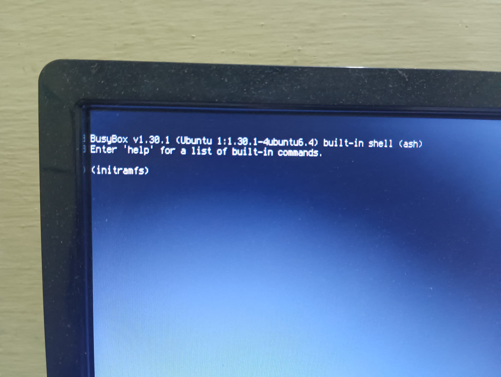
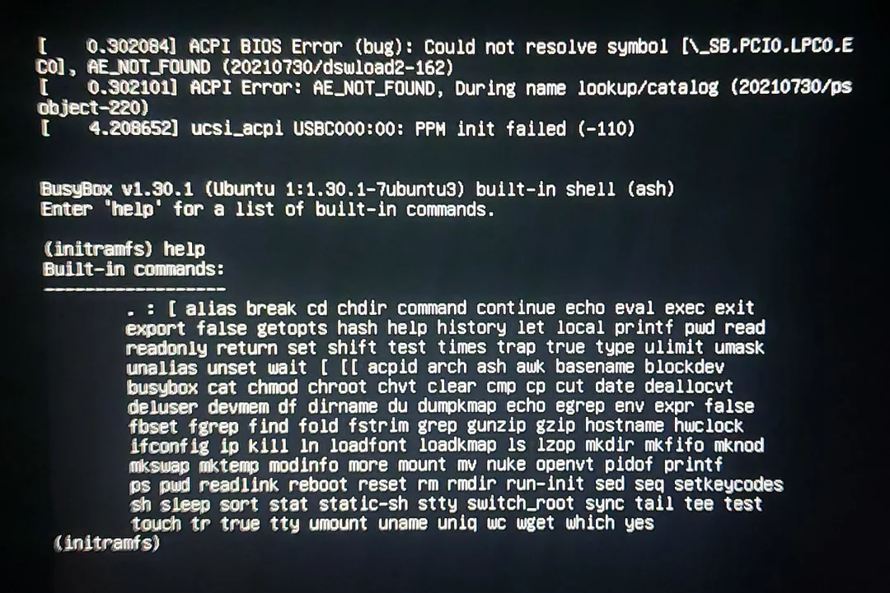
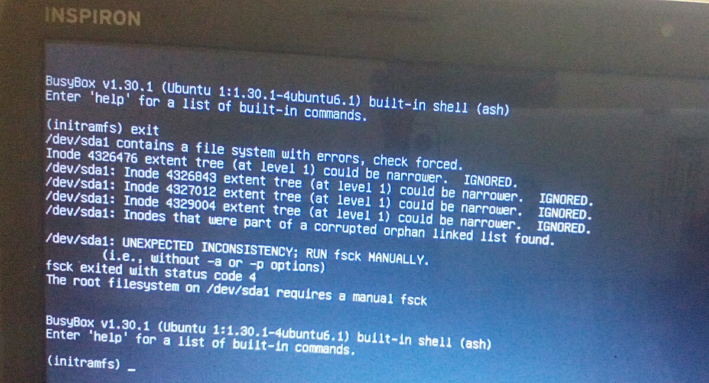
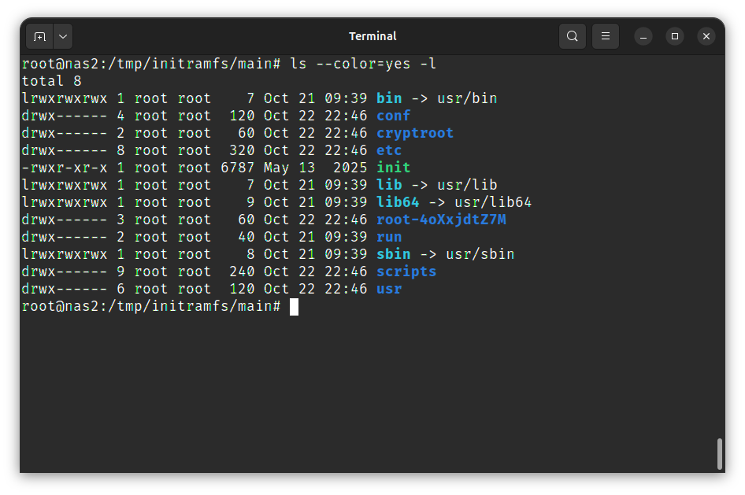
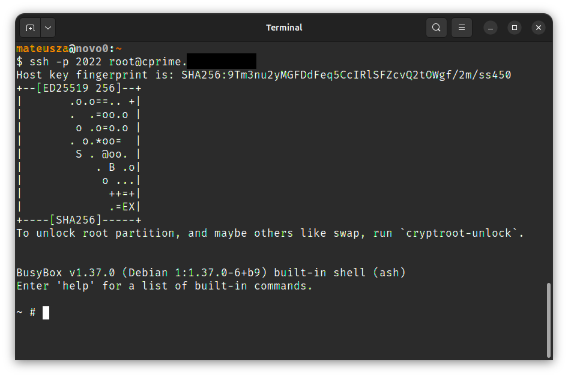
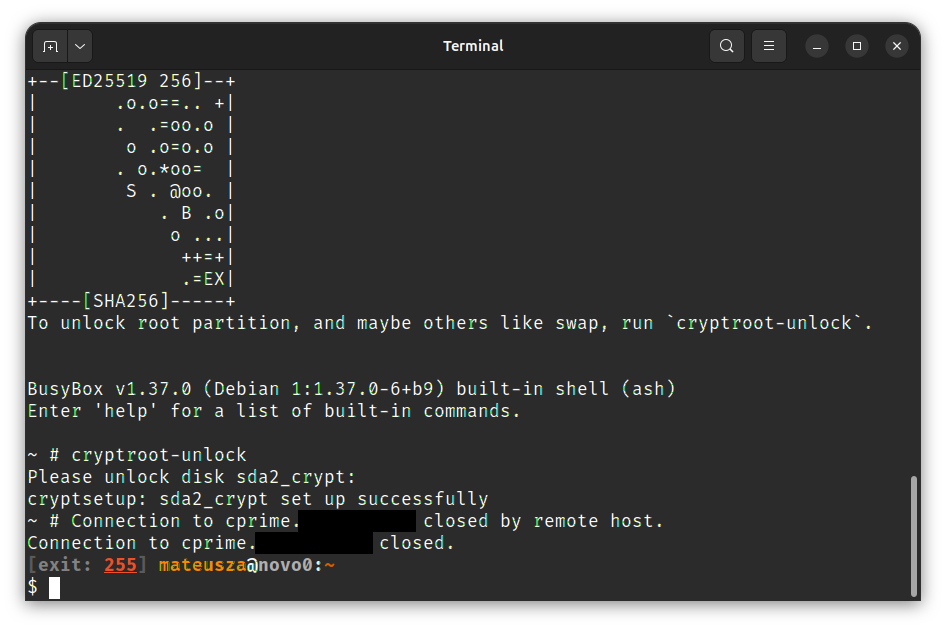
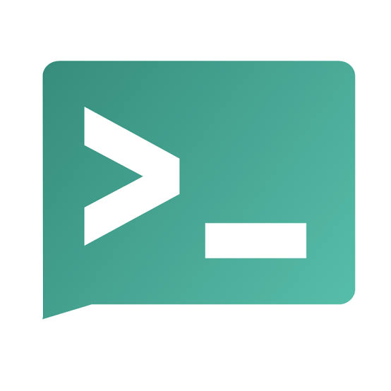
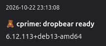

<!-- .slide: data-background-image="img/jesien-linuksowa-bg-gray.png" -->
<!-- .slide: data-background-size="contain" -->
<!-- .slide: data-autofragments -->
<!-- .slide: data-background="#d8d8d8" -->

# Initramfs
<!-- .element: style="margin-top: 1em; margin-bottom: 0;" -->
## tajemniczy etap startu Linuksa
<!-- .element: style="margin-top: 0; font-size: 0.8em;" -->

Mateusz Adamowski
<!-- .element: style="font-size: 0.8em;" -->

Jesień Linuksowa 2026  
Kraków, 2026-10-23
<!-- .element: style="font-size: 0.8em;" -->

---
<!-- .slide: data-autofragments -->
## O mnie

- sysadmin (od 2005)
- programista (Python, Bash, JS, C)
- miłośnik Linuksa (od 2000)
- szkoleniowiec

------
<!-- .slide: data-background="#eee" -->

# initramfs

Komu to potrzebne?

---
<!-- .slide: data-background="#000" -->


---
<!-- .slide: data-background="#000" -->


---
<!-- .slide: data-background="#000" -->


---
<!-- .slide: data-autofragments -->

## Czy initramfs jest potrzebny?

Często nie

Ale po kolei...

------
<!-- .slide: data-autofragments -->
# Start systemu

- UEFI / BIOS
- GRUB
- kernel
- initrd
- systemd
- usługi, GUI

---
<!-- .slide: data-autofragments -->
## BIOS

Umie wczytać MBR  
(446 bajtów)

Nie rozumie tablicy partycji, systemów plików

---
<!-- .slide: data-autofragments -->
## UEFI

- Tablica partycji  
  (MBR lub GPT)
- FAT

---
<!-- .slide: data-background="#4d4" -->

BIOS lub UEFI wczytuje bootloader (GRUB)

---
<!-- .slide: data-autofragments -->
## GRUB

- Tablica partycji
- FAT, ext4, XFS, ISO-9660

<small>(w ograniczonym stopniu też: LVM, RAID, LUKS)</small>

---
<!-- .slide: data-background="#4d4" -->
<!-- .slide: data-autofragments -->

## GRUB

1. wczytuje plik konfiguracyjny
2. ładuje kernel (i initrd)

---
<!-- .slide: data-background="#4d4" -->
<!-- .slide: data-autofragments -->

## Kernel

1. uruchamia się
2. montuje dysk (`root=`)
3. uruchamia proces `init` (PID 1)

---
<!-- .slide: data-autofragments -->
## Jak dostać się do dysku systemowego?

- dostanie się do dysku wymaga modułów
- moduły są na dysku

---
<!-- .slide: data-autofragments -->
## initramfs

- minimalistyczne środowisko
- całkowicie w RAM-ie
- sterowniki i podstawowe narzędzia

------
<!-- .slide: data-autofragments -->
<!-- .slide: data-background="#822" -->
## initrd?

---
## ramdisk vs ramfs
<!-- .slide: data-autofragments -->
- RD - ramdisk
- ramfs - RAM filesystem

---
<!-- .slide: data-autofragments -->
<!-- .slide: data-background="#822" -->
## struktura initrd

- urządzenie blokowe
- ext2

------
<!-- .slide: data-autofragments -->
# struktura initramfs

- archiwum cpio

---


---
## skrypt `init`

<iframe src='assets/initramfs-init.html' style='width: 60vw; height: 40vh;'></iframe>

---
<!-- .slide: data-autofragments -->
# cpio?

- poprzednik tara

------
<!-- .slide: data-autofragments -->
# Busybox

- lekka implementacja coreutils
- ... i nie tylko

------
<!-- .slide: data-autofragments -->
# Narzędzia

- `lsinitramfs`
- `unmkinitramfs`

------
<!-- .slide: data-autofragments -->
# cryptroot

- szyfrowany dysk wymaga hasła...
- **PODAJ HASŁO: ...**
- ... lokalnie

---

<!-- .slide: data-autofragments -->
Use case #1:

# zdalne wprowadzanie hasła

- jak podać hasło zdalnie?

---
<!-- .slide: data-autofragments -->
## zdalny dostęp do initramfs

- sieć (DHCP lub statyczny IP)
- serwer SSH

---
<!-- .slide: data-autofragments -->
## dropbear

- mały serwer SSH w initramfs
- gotowa integracja w Debianie:  
  `apt-get install dropbear-initramfs`
- (trzeba wrzucić klucze SSH)

---


---


---
<!-- .slide: data-autofragments -->
## Dropbear

- uwierzytelnianie tylko na klucze
- warto używać innego portu
- podawanie hasła można zautomatyzować

------
<!-- .slide: data-autofragments -->
# initramfs w Debianie

- `update-initramfs`
- `/usr/share/initramfs-tools`
- `/etc/initramfs-tools`

---
<!-- .slide: data-autofragments -->
## Rozbudowywanie initramfs

- trzy rodzaje plików:
  - conf.d
  - hooki
  - skrypty
- konfiguracja: `/etc/initramfs-tools`
- przebudowa obrazu: `update-initramfs -u`

---
<!-- .slide: data-autofragments -->
## conf.d

- pliki konfiguracyjne
- ładowane automatycznie
- zmienne środowiskowe

---
<!-- .slide: data-autofragments -->
## hooks

- uruchamiane podczas budowania
- kopiują do obrazu potrzebne pliki  
  (programy, biblioteki, moduły, konfiguracje)

---
## przykładowy hook

```sh
#!/bin/sh

[ "$1" = "prereqs" ] && exit 0

. /usr/share/initramfs-tools/hook-functions

copy_exec /bin/busybox /bin/busybox.full
```

---
<!-- .slide: data-autofragments -->
## `hook-functions`

- `copy_exec`: wgraj program (wraz z bibliotekami)
- `copy_file`: wgraj dowolny plik
- ...

---
<!-- .slide: data-autofragments -->
# skrypty

- uruchamiane przez `init` w `initramfs`
- kilka etapów do wyboru

---

```
    init-top        (przed załadowaniem modułów)
        ↓
    init-premount
        ↓
    local-top
        ↓
    local-premount
        ↓
    local-bottom    (po zamontowaniu /)
        ↓
    init-bottom
        ↓
    *** start normalnego systemu ***
```
---

# szablon skryptu

```sh
#!/bin/sh

PREREQ="udev"

prereqs() {
    echo "$PREREQ"
}

case "$1" in
    prereqs)
        prereqs
        exit 0
    ;;
esac
```

---
<!-- .slide: data-background="#822" -->
# Uwaga

Skrypt jest uruchamiany również w trakcie budowania `initramfs` w celu ustalenia kolejności wykonywania przez `init`.

Parametr: `prereqs`

------
<!-- .slide: data-autofragments -->
Use case #2

# wireguard

---
## hook

```sh
...

copy_exec /usr/bin/wg /usr/bin/wg

manual_add_modules wireguard

copy_file conffile /etc/initramfs/wg0.conf /conf/wg0.conf
```

---
<!-- .slide: data-autofragments -->
<!-- .slide: data-background="#411" -->
## wg

- nie korzystamy z `wg-quick`
- część kroków robimy *ręcznie*

---
## skrypt (init-premount)

```sh
...

ip link add "$interface" type wireguard
ip link set "$interface" up
wg setconf "$interface" /conf/wg0.conf

ip address add "$addr" dev "$interface"
ip route add "$route" dev "$interface"
```

------
<!-- .slide: data-autofragments -->
Use case #3

## wifi

---
## hook

```sh
...

copy_file conffile /etc/initramfs-tools/wpa_supplicant.conf \
            /conf/wpa_supplicant.conf

copy_exec /usr/sbin/iw
copy_exec /usr/sbin/wpa_supplicant
copy_exec /usr/sbin/wpa_cli

manual_add_modules mwifiex_sdio
```

---
## skrypt (init-premount)

```sh
...

modprobe "$WLAN_MODULE"
sleep 5

for TTT in 4 8 16 32; do
    wpa_supplicant -B -i wlan0 -c /conf/wpa_supplicant.conf
    ipconfig -t "$TTT" -d wlan0 && exit 0
    wpa_cli -p /run/wpa_supplicant -i wlan0 terminate
    echo "Wifi retrying"
    sleep "$TTT"
done
```

------
<!-- .slide: data-autofragments -->

Use case #4

## notyfikacje

- `curl` / `wget` mogą wysłać informację o postępie startu
- np. błąd montowania rootfs albo gotowość do odblokowania LUKS
- sieć, DNS i certyfikaty CA muszą być dostępne w initramfs

---
<!-- .slide: data-background="#fff" -->

## ntfy.sh



---

## conf.d/ntfy

```
NTFYSH_HOSTNAME="mojserwer01"
NTFYSH_TOPIC="jesien_linuksowa_2026"
```

---

## skrypt (init-premount)

```sh
(
  attempts=10
  while [ "$attempts" -gt 0 ]; do
    wget -q -T 5 -O /dev/null \
      --no-check-certificate \
      --post-data="$(uname -r)" \
      --header="Title: ${NTFYSH_HOSTNAME}: dropbear ready" \
      --header='Tags: teddy_bear' \
      "https://ntfy.sh/${NTFYSH_TOPIC}" && break

    attempts=$((attempts - 1))
    [ "$attempts" -gt 0 ] && sleep 5
  done
) &
```

---



------
<!-- .slide: data-autofragments -->
# Więcej pomysłów

- ntp
- iptables
- bootsplash (plymouth)

------

# Initramfs from scratch

---
<!-- .slide: data-autofragments -->
# Budowa własnego initramfs od zera

- `busybox` jako /bin/sh
- trywialny `init`
- spakowanie `cpio`

---

## trywialny init

```
#!/bin/sh

echo "Welcome to myinitramfs!"
sh
```

---
## budowa initramfs

```sh
mkdir -p initramfs && cd initramfs
mkdir -p bin
cp "$SRC/busybox" bin/busybox
cp "$SRC/init" bin/init
ln -s busybox bin/sh
find . | cpio --owner=0:0 -H newc -o > ../initrd
```

------
<!-- .slide: data-autofragments -->
# Diskless?

A gdyby tak nie montować dysku i zostać w RAM-ie na zawsze?

---
<!-- .slide: data-autofragments -->
# Diskless
## (aka LiveCD)

- docelowy `rootfs` spakowany wewnątrz initramfs

---
## przejście do nowego systemu

```
mount -t proc proc /proc
memsize="$(sed -ne '/^MemTotal/s/^.*: *\(.*\) kB$/\1/p' /proc/meminfo)"
umount /proc

mkdir -p /newroot
mount -t tmpfs -o "size=${memsize}k,mode=0755" tmpfs /newroot

tar -x -C /newroot --strip-components=1 < /rootfs.tar
exec /bin/run-init /newroot /sbin/init "$@"
```

---
## A może squashfs?

```
mkdir -p /rootfs-ro
mount -t squashfs -o loop,ro /rootfs.squashfs /rootfs-ro
mkdir -p /overlay /newroot

memsize="$(sed -ne '/^MemTotal/s/^.*: *\(.*\) kB$/\1/p' /proc/meminfo)"
mount -t tmpfs -o "size=${memsize}k,mode=0755" tmpfs /overlay

mkdir -p /overlay/upper /overlay/work
mount -t overlay overlay \
  -o lowerdir=/rootfs-ro,upperdir=/overlay/upper,workdir=/overlay/work \
  /newroot
```

---
<!-- .slide: data-autofragments -->
# Co dalej?

- kernel i initramfs można wczytać też przez PXE lub iPXE
- zastosowania:
  - systemy ratunkowe
  - bezstanowe serwery usług (*stateless*)
- ograniczenia: pamięć RAM, czas startu i brak trwałego zapisu

------
<!-- .slide: data-autofragments -->
# dracut

- generator initramfs używany m.in. w Fedorze i RHEL
- moduły dobierają potrzebne funkcje: LVM, LUKS, RAID, sieć
- obraz dopasowany do hosta albo ogólny
- budowanie: `dracut -f`
- zawartość obrazu: `lsinitrd`

------
<!-- .slide: data-autofragments -->
# systemd w initramfs

- `systemd` może być PID 1 w initramfs
- funkcjonalność initramfs zaimplementowana jako jednostki systemd
- po przygotowaniu systemu następuje przejście do właściwego rootfs
- Ubuntu 26.04

------
<!-- .slide: data-autofragments -->
# ukify

- jeden plik EFI może zawierać cały obraz startowy
- narzędzie projektu systemd
- UKI łączy kernel, initramfs i wiersz poleceń kernela
- można go podpisać do uruchamiania z Secure Boot

---
# ukify

```sh
ukify build \
    --linux=kernel-x.y.z" \
    --initrd=initrd-x.y.z.gz" \
    --cmdline="console=tty0" \
    --output="mojsystem.efi"
```

------
<!-- .slide: data-autofragments -->
# warsztaty

- kiedy? niedziela, 8:55
- BYOL - bring your own laptop
- zainstaluj wcześniej:
  - Virtualbox
  - docker
  - qemu

------
<!-- .slide: data-autofragments -->
# Materiały

- materiały i pozostałe slajdy:

[mateusza-szkolenia.github.io](https://mateusza-szkolenia.github.io/)

------

[Koniec](./)
